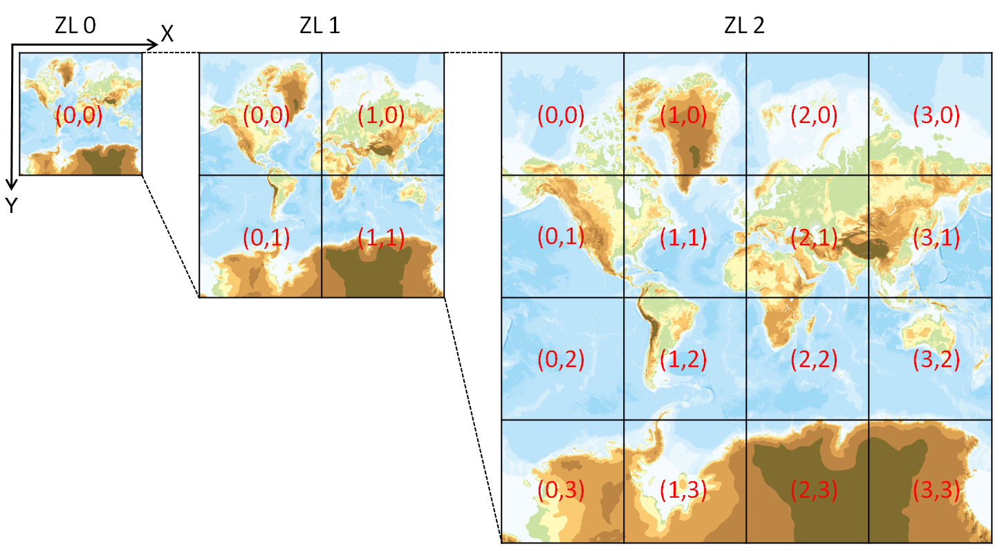

## はじめに

*<https://maps.gsi.go.jp/development/siyou.html> より引用、地図タイルのイメージ*

地図タイルとは、ズームレベル（≒解像度）別にタイル状に分割された地図データのことです。例えば0/0/0という番地のタイルは`https://cyberjapandata.gsi.go.jp/xyz/std/0/0/0.png`で得られます。整数値3つからタイルの領域が一意になるのが、地図タイルの利点です。

## 地図タイルサーバー

地図タイルの作成方法には、①巨大なデータを事前にタイルに分割しておく方法、②リクエストがあった際にそのタイルを作成する方法の、2つがあります。メジャーなのは前者です。立派なサーバーや難しい実装がなく簡単に作成・配信できるためです。

①は静的タイルなどと呼ばれることがあり、作成方法は以下にまとまっています。

<https://qiita.com/Kanahiro/items/4b5f8db5743c69741220>

<https://qiita.com/Kanahiro/items/ceeb20c158b4c70b62b6>

②は動的タイルと呼ばれ、こちらもいくつか方法がありますが、本筋よりも充実した内容となってしまうため、ここでは詳細の説明は割愛します。

ここでは、z/x/yのリクエストに対してタイルをレスポンスするサーバーのことを「地図タイルサーバー」と呼ぶことにします。

## chiitiler

<https://github.com/Kanahiro/chiitiler>

chiitiler（ちぃたいらー）は、動的にラスタータイルを配信するサーバーです。名前には「小さいタイルサーバー」という意味が込められています。

ラスタータイルとは画像なわけで、つまりサーバー上で画像をレンダリングしなければなりません。レンダリングするためには「地図スタイル」というものが必要となり、この地図スタイルは、ソフトウェアによって全く考え方や仕組みが異なります。例えば[MapServer](https://mapserver.org/)というソフトウェアは様々なGISデータを利用でき、MapFileにスタイルを記述することで地図をレンダリングします。一方、[MapLibre](https://maplibre.org/)では、使われるデータは主にベクトルタイルで、スタイルはMapLibre Style Specificationで定義されるJSON構造で記述します。

chiitilerは、MapLibre Style Specificationをレンダリングする地図タイルサーバーです。

### TileserverGL

MapLibre Style Specificationのタイルサーバーには[TileserverGL](https://github.com/maptiler/tileserver-gl)というデファクトスタンダードがあります。素晴らしいソフトウェアで、今後も使われ続けると思いますが、昨今のパブリッククラウド・サーバーレスの世界で使うには難があると考えていました。というのは、ベクトルタイルなどのデータをサーバー内に保持する必要があるためです（たとえばAWS S3とかに置きたい）。

### chiitilerの特徴と使い方

chiitilerは`Lightweight Raster Tile Server`と謳っており、TileserverGLが持つ上記の課題を解決するため以下のような機能か実装されています：

1. AWS S3のサポート
2. PMTilesなどのサポート
3. ダウンロードしたデータのキャッシング機構
4. AWS Lambdaで利用出来るコンテナイメージ

1,2はサーバーのファイルシステムに依存しないためのもの、3はパフォーマンスを維持・向上するため、4はそもそもこのサーバーはLambda用に実装したためです（[参考: コンテナランタイムとしての AWS Lambda](https://aws.amazon.com/jp/builders-flash/202402/lambda-container-runtime/)）。もちろん通常のサーバーでも動作させられます。

コンテナイメージを公開しているので、これを使うと簡単に使い始められます。

```sh
# このコマンドを実行するだけ
docker run -d -p 3000:3000 ghcr.io/kanahiro/chiitiler
```

サーバーが起動すると、以下のURLでタイルを取得出来るようになります。
ポイントは、リクエスト時にstyle.jsonを渡したら、そのラスタータイルが得られるということです。非常にシンプル。

```planetext
http://localhost:3000/tiles/{z}/{x}/{y}.webp?url=https://demotiles.maplibre.org/style.json

# PNG形式、マージン設定（タイルの境でラベルが切れてしまうなどの場合に設定）
http://localhost:3000/tiles/{z}/{x}/{y}.png?margin=100&url=https://tile.openstreetmap.jp/styles/maptiler-toner-en/style.json

# JPEG形式、256pxタイル、圧縮品質=80
http://localhost:3000/tiles/{z}/{x}/{y}.jpg?tileSize=256&quality=80&url=https://tile.openstreetmap.jp/styles/osm-bright/style.json
```

:::note info
urlには任意のURLを渡せます。つまり任意のURLのデータをダウンロードさせることになるので、このサーバーを直接外部に公開することは非推奨です。マイクロサービスとしての利用を推奨します。
参考: <https://zenn.dev/mierune/articles/d16af7ca873e14#%E6%96%B0%E3%82%B7%E3%82%B9%E3%83%86%E3%83%A0%E3%81%AE%E6%A7%8B%E6%88%90>
:::

#### デバッグモード

すぐに表示確認出来るように、デバッグモードを用意しています。

```sh
docker run -d -p 3000:3000 ghcr.io/kanahiro/chiitiler tile-server -D
# http://localhost:3000/debug でデバッグページが見られる。
# http://localhost:3000/debug?url=https://tile.openstreetmap.jp/styles/osm-bright/style.json
```

#### キャッシュ機構

このサーバーの性質上、レンダリング時に素材となるデータをダウンロードする必要があります。一度ダウンロードしたデータは、キャッシュしておいて次回以降の処理に利用したい訳です。ということでそういう機構が実装されています（オンメモリ・ファイルシステム・S3をサポートしています）。S3にキャッシュとはどういうことかというと、サーバーレスに動かす場合はファイルシステムをアテには出来ず、マシンインスタンスが何台あっても同じように利用するためには（かつ安く）、S3が便利ということです。

```sh
# S3にダウンロードしたファイルをキャッシュする設定
docker run -p 3000:3000 ghcr.io/kanahiro/chiitiler tile-server -c s3 -s3b bucket_name -s3r ap-northeast-1
```

S3を利用する場合、結局はファイルを「ダウンロード」するわけですが、AWS LambdaからAWS S3のダウンロードなら物理的に近くて速いだろう（実際速いしオリジンの負荷軽減にもなる）ということで、それなりに意味がありそうです。ただしデータがそもそもS3にある場合は意味がないです。

:::note info
生成した画像自体をキャッシュする機構は、chiitilerは持っていませんし今後も持つつもりはありません。CDNで対応出来るためです。
:::

#### 環境変数

パラメータは、コマンドライン引数より環境変数で渡すことを推奨しています（コンテナ環境で都合がよいため）。

```sh
docker run -p 3000:3000 -d \
-e CHIITILER_CACHE_METHOD=s3 \
-e CHIITILER_S3CACHE_BUCKET=bucketname \
-e CHIITILER_S3_REGION=ap-northeast-1 \
ghcr.io/kanahiro/chiitiler
```

### 利用例

<https://zenn.dev/mierune/articles/d16af7ca873e14>

<https://github.com/MIERUNE/tiles>

MIERUNEが無料で公開している地図タイル「MIERUNE」「MIERUNE MONO」はchiitilerを利用して配信されています。


*MIERUNE: <https://tile.mierune.co.jp/mierune/{z}/{x}/{y}@2x.png>*

*MIERUNE MONO: <https://tile.mierune.co.jp/mierune_mono/{z}/{x}/{y}@2x.png>*

GitHubに記載の利用条件を守れば無料で利用できます。ぜひ使ってください。

#### 参考: AWS Lambdaのメトリクス


*AWS Lambdaのレスポンスまでの所要時間*

平均レスポンスタイムは100ms程度で、コールドスタート時に3秒程度かかる、という結果です。動的タイルを100ms程度でレスポンス出来ているのは優秀に思います。

また、料金はリクエスト数に応じて増減しますが、現状はかなり安く運用出来ています。Lambda最高！

:::note info
これらのスタイルには特にレンダリングの負荷が高いsymbolレイヤー（ラベルやアイコン）が含まれていないので、速いということではあります。
:::

## 終わりに

ベクトルタイルの利用はもはや当たり前になりつつありますが、Mapbox/MapLibre以外だと、やはりレンダリングに難がある状況です（QGISはベクトルタイルをサポートしているがスタイルは未だ不完全）。なのでラスタータイルの有用性は今後もあり続けるでしょう。そんななか、サーバーレスに動かせるラスタータイルサーバーとして、chiitilerが利用されるようになったら嬉しいです。
